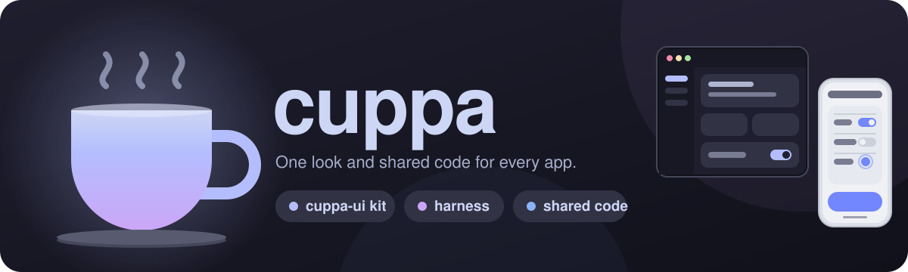
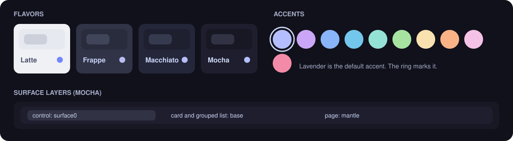
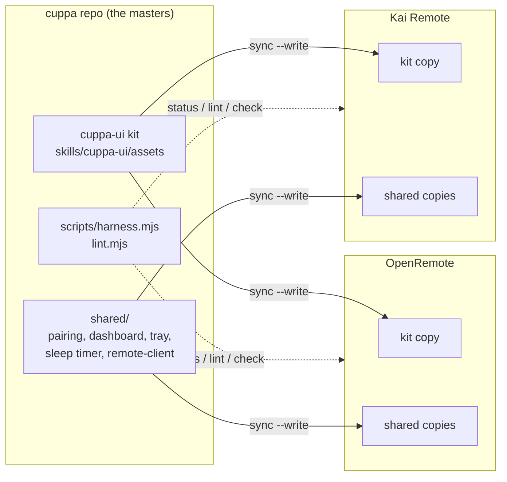

<p align="center"></p>

<p align="center">
  
  
  
  
  
</p>

A Claude Code plugin for keeping any set of apps looking and behaving the same. It has two parts, and neither is tied to one kind of project:

|  | **cuppa-ui** | **harness** |
|---|---|---|
| **What** | An Apple-style UI kit on Tailwind v4 and Catppuccin, offline, no CDN and no webfonts | Tooling that keeps your projects in step: one copy of the kit and of any shared code, checked and synced into each |
| **Gives you** | Buttons, rows, sheets, toasts, loaders, tab bars, an icon sprite, a theme switcher | `status`, `sync`, `lint`, `check` and `init`, driven by one `harness.json` |
| **Use it for** | Any web app, dashboard, PWA or settings screen that should look consistent | Any group of projects that share a look or code, in any language |
| **Skill** | `cuppa:cuppa-ui` | `cuppa:harness` |

## Install

```
/plugin marketplace add amogh-w/cuppa
/plugin install cuppa@cuppa
```

Try it without installing: `claude --plugin-dir <path to this repo>`.

## Look

One palette, four flavors, one default accent. Layers go page, then card, then control, so a surface never reads inverted.

<p align="center"></p>

The kit's theme is one file, `theme.js`. It stores `ui-flavor`, `ui-accent` and `ui-radius`, and no app writes a second switcher. Motion has one scale (150 ms, 200 ms, or 260 to 500 ms; transform and opacity only), set once in `references/motion.md`.

## How the pieces fit



Masters live here. Projects hold copies, and `harness status` reports any drift. Edit the master, run `sync --write`, never the copy.

## Set it up for your projects

1. Install the plugin (above) and clone this repo somewhere, since the commands run from it.
2. Copy `harness.example.json` to `harness.json` (it is git-ignored) and list your projects: where each one lives, where it keeps its copy of the kit, and which shared files it takes.
3. Run `node scripts/harness.mjs status`. It shows which projects have drifted from the masters, and `sync --write` repairs them.
4. Optional: add a `ui` section to a project and run `lint` to enforce the cuppa-ui rules in its own code.

Only want the kit? Skip the harness: the `cuppa-ui` skill works on its own in any project.

## Commands

`<h>` is `node scripts/harness.mjs`.

| Command | What it does |
|---|---|
| `<h> status` | Reports drift between the masters and every project. Exit 1 if any. |
| `<h> sync --write` | Copies the kit and the shared code into each project. |
| `<h> lint [id]` | Checks a project's own UI against the cuppa-ui rules. Every finding fails. |
| `<h> check [id]` | Runs each project's `scripts\check.ps1` (fmt, clippy, tests), then this repo's tests. |
| `<h> init <dir> --id <id>` | Scaffolds `check.ps1`, CI, `rustfmt.toml`, `CLAUDE.md` and `README.md` for a new project. |

## Shared code that ships with it

`shared/` holds ready-made modules for apps with a Rust (axum) server and a phone web app. They were written for two such apps (OpenRemote and Kai Remote). Map the ones you want in `harness.json`; ignore the rest. Add your own the same way (see `skills/harness/references/new-shared-module.md`).

| Module | Where | Does |
|---|---|---|
| Pairing | `pairing.rs`, `pairroutes.rs`, `pair-client.js`, `pair-screen.html` | One offer, three ways in: a typed 6-digit code, a QR, a link. Per-phone keys, only hashes stored. |
| Dashboard | `admin.rs`, `admin.html`, `admin.js` | Loopback-only page: add, rename and remove devices, pause pairing. |
| Tray | `shell.rs`, `autostart.rs` | Open dashboard, Copy phone link, Start with Windows, Restart, Exit. One instance per port. |
| Sleep timer | `sleeptimer.rs` | Set, cancel, end of episode, pushed to every phone. |
| Network guard | `netguard.rs` | Host and Origin checks against DNS rebinding and cross-site requests. |
| Phone link | `remote-client.js` | Reconnect with backoff, silent-link detection. |
| Log | `applog.rs` | Rotating event log that never holds secrets. |

## The lint, in one list

`harness lint` fails on any of these in a project's own UI code:

- hex colors (only the `theme-color` meta may have one), CDN or external URLs, emoji glyphs
- icon names that are not in `icons.txt`
- durations, easings and animated properties off the motion scale
- radii and type sizes off the kit's scale
- surfaces used in the wrong layer
- `innerHTML` with anything but literals, `esc()`, `raw()` or `ico()`
- icon-only buttons without `aria-label`
- a second theme switcher, or storage keys without the app prefix

## Guides

| I want to | Read |
|---|---|
| Use or extend the UI kit | `skills/cuppa-ui/SKILL.md` |
| Sync, check or change shared code | `skills/harness/SKILL.md` |
| Add a feature both apps need | `skills/harness/references/new-shared-module.md` |
| Write or change a README | `skills/harness/references/readme.md` |
| Start a new project in the family | `skills/harness/references/new-project.md` |
| Understand what is shared and why | `skills/harness/references/architecture.md` |

## Working on it

Edit in this folder, not in `~/.claude/plugins/cache`, which is a managed snapshot. After a change run `node scripts/harness.mjs sync --write`, bump `version` in `.claude-plugin/plugin.json`, then `/plugin update cuppa@cuppa`.

```
node --test "tests/*.test.mjs" "shared/*.test.mjs"
```

`harness.json` is yours: it lists your projects and holds this machine's paths, so it is not in the repo. `harness.example.json` is the template.
